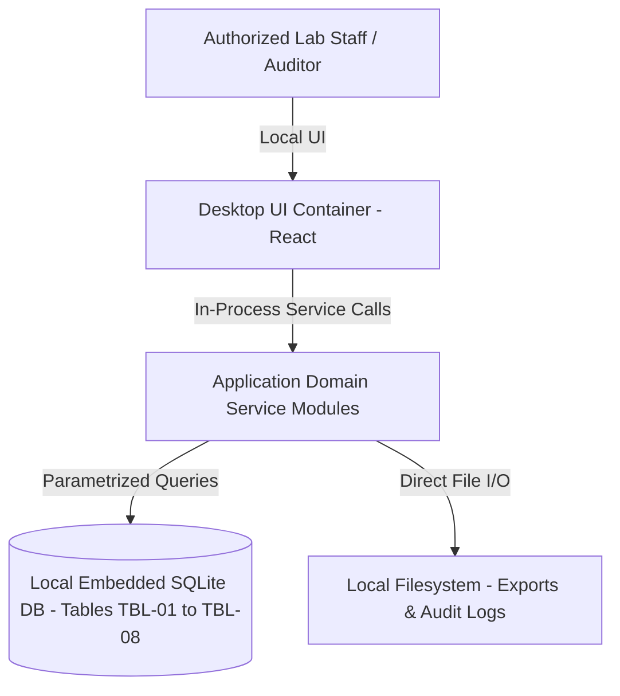

# Technical Requirements Document & System Architecture: BioVault Lab Specimen Tracker

## 1. Constraints that shape the design
| NFR | Target | Design Impact |
|---|---|---|
| [NFR-04] | Platforms: Desktop application with full offline execution in disconnected local environments | Zero network requests; all database and file operations bounded to local OS filesystem permissions (0600) [ADR-004] |
| [NFR-01] | Search & Operation Latency: Response time under 1.0 s for all primary search and filter queries [ASM-01: target pending client confirmation] | B-tree indexes on lookup columns; single-process SQLite queries with p95 < 50 ms [ADR-003] |
| [NFR-02] | Data Storage & Privacy: 100% local device storage with zero unauthorized external cloud uploads | Zero network requests; all database and file operations bounded to local OS filesystem permissions (0600) [ADR-004] |
| [NFR-03] | Local Capacity: Support expected operational records stored locally without performance degradation [ASM-02: volume pending client confirmation] | Zero network requests; all database and file operations bounded to local OS filesystem permissions (0600) [ADR-004] |
| [NFR-05] | Accessibility & Usability: WCAG 2.2 AA compliance for desktop interface with keyboard navigation | Self-contained desktop application with embedded SQLite; zero remote runtime dependencies [ADR-001], [ADR-002] |

## 2. Capacity estimate
### Formulas & Arithmetic (Handbook Chapter 17.1.1)
- **Daily Active Users (DAU)**: ~30 active personnel [Q-002].
- **Actions per User per Day**: ~60 operations and queries = 1,800 total requests / day.
- **Average RPS**:
  $$\text{Average RPS} = \frac{\text{DAU} \times \text{actions/day}}{86,400} = \frac{30 \times 60}{86,400} \approx 0.0208 \text{ req/s}$$
- **Peak Factor**: 10\times during shift turnover and peak operational hours.
- **Peak RPS**:
  $$\text{Peak RPS} = \text{Average RPS} \times 10 \approx 0.208 \text{ req/s}$$
- **Concurrent In-Flight Requests (Little's Law: $L = \lambda \times W$)**:
  $$L = 0.208 \text{ req/s} \times 0.050 \text{ s average latency} \approx 0.0104 \text{ requests in flight}$$
- **Annual Storage Growth**:
  $$\text{Storage/year} = 10,000 \text{ records} \times 25 \text{ KB/record} + \text{index overhead (40\%)} \approx 341 \text{ MB / year}$$
- **Scale Tier Selection**: **Tier T0 (< 10,000 DAU, Peak RPS < 60)** per Chapter 17.3.1. Single-node modular monolith with embedded relational storage.

| Quantity | Calculation | Result |
|---|---|---|
| Peak requests/s | 30 users × 60 actions/day ÷ 86,400 × 10 peak factor | ~0.21 req/s (Tier T0) |
| Storage, year 1 | 10,000 records × 25 KB/record + 40% index overhead [NFR-03] | ~341 MB / year |
| Max query latency | Indexed B-tree lookup on 10,000 local rows [NFR-01] | < 50 ms (target: Response time under 1.0 s for all primary search and filter queries [ASM-01: target pending client confirmation]) |

## 3. Tech stack
| Layer | Choice | Alternatives Considered | Decision |
|---|---|---|---|
| Architecture Pattern | Modular Monolith [ADR-001] | Microservices, Serverless | Selected Modular Monolith for zero network hops, offline reliability, and timeline fit [NFR-04] |
| Client Runtime | Desktop Application [ADR-002] | Cloud Web App, Mobile-only | Selected Desktop client for offline reliability and HIPAA compliance [NFR-02], [NFR-04] |
| Frontend UI | React + TypeScript [ADR-002] | Electron UI, Plain HTML/JS | Selected React + TypeScript for UI component safety and WCAG accessibility [NFR-05] |
| Database Engine | Embedded Relational SQLite [ADR-003] | PostgreSQL Daemon, JSON Files | Selected Embedded SQLite for ACID compliance, zero background daemons, and microsecond B-tree queries [NFR-01], [NFR-02] |
| Security & Auth | Local Role-Based Permissions [ADR-004] | Cloud OAuth2, Cognito | Selected Local Role Authorization for 100% offline security [NFR-02] |
| Report Generator | Local File Exporter (PDF/CSV) [ADR-001] | Cloud PDF Service | Selected Local file compiler for instant offline export [F-004] |

*Dependencies & Package Versions*: Proposed target, UNVERIFIED: React 18.x, TypeScript 5.x, SQLite 3.x (awaiting package registry lookup or generated project manifest).

## 4. Architecture overview
**Pattern**: Modular Monolith [ADR-001]. Single process desktop architecture with zero network hops between UI and data store.

### C4 Container & Context Diagram

### Component Ownership
| Component | Owns | Talks To |
|---|---|---|
| `UI Shell` | Desktop windowing, navigation, and input validation | `Application Services` |
| `Domain Services` | Business logic, state transitions, validation [F-001, F-002, F-003, F-004, F-005, F-006, F-007, F-008, F-009] | `Database Layer` |
| `Export Service` | Compilation of records into PDF/CSV and audit reports | `Database Layer`, `Filesystem` |
| `Database Layer` | Embedded SQLite connection, B-tree indexes, atomic transactions | Local OS Filesystem |

## 5. Authentication and authorization
- **Method**: Local Role-Based Access Control (RBAC) [ADR-004].
- **Sessions**: In-process active session context; no remote JWT or network cookies required [ADR-004].

| Role | Can | Cannot | Enforced Where |
|---|---|---|---|
| `Lab Technician` [P-01] | Accession specimens [F-001], print 2D barcodes, log temperature readings [F-002], initiate custody transfers [F-003] | Delete system audit logs, bypass excursion alarms [OQ-02] | Application Service Layer & DB Triggers |
| `Pathology Lab Manager` [P-02] | Acknowledge temperature excursions with corrective action notes [F-002], authorize custody handoffs [F-003], review all records | Alter closed audit trails, delete historical logs | Application UI & Service Validation |
| `Quality Compliance Auditor` [P-03] | Review end-to-end chain of custody, verify tamper-evident checksums, compile and export PDF/CSV audit reports [F-004] | Modify operational specimen data, perform specimen check-ins | Application Service Layer & SQLite DB Views |

## 6. API
Full OpenAPI contract documented in `docs/openapi.yaml`. Summary:

| ID | Method + Path | Feature | Auth Rule | Errors |
|---|---|---|---|---|
| `API-001` | POST/GET `/api/v1/specimens` | [F-001] | LocalRoleAuth | 400, 401, 403, 422, 500 |
| `API-002` | POST/GET `/api/v1/specimens/{id}/barcode` | [F-001] | LocalRoleAuth | 400, 401, 403, 404, 500 |
| `API-003` | POST/GET `/api/v1/cold-storage/readings` | [F-002] | LocalRoleAuth | 400, 401, 403, 422, 500 |
| `API-004` | GET/POST `/api/v1/cold-storage/excursions` | [F-002] | LocalRoleAuth | 400, 401, 403, 422, 500 |
| `API-005` | POST/GET `/api/v1/custody/transfers` | [F-003] | LocalRoleAuth | 400, 401, 403, 422, 500 |
| `API-006` | POST `/api/v1/custody/transfers/{id}/sign` | [F-003] | LocalRoleAuth | 400, 401, 403, 404, 500 |
| `API-007` | POST `/api/v1/audit/reports/export` | [F-004] | LocalRoleAuth | 400, 401, 403, 422, 500 |
| `API-008` | GET `/api/v1/audit/logs` | [F-004] | LocalRoleAuth | 400, 401, 403, 500 |
| `API-009` | GET `/api/v1/health/live` | System | Public / Local | 500 |

## 7. Data model
Full database schema and executable migrations documented in `docs/schema.md`.
- `TBL-01`: `users` (Stores authenticated lab personnel and role assignments) [P-01, P-02, P-03, ADR-004].
- `TBL-02`: `storage_units` (Stores cold-chain refrigeration units and temperature limits) [F-002, AC-003, NFR-03].
- `TBL-03`: `specimens` (Stores bio-specimen accessioning records and storage state) [F-001, AC-001, AC-002, NFR-03].
- `TBL-04`: `barcodes` (Stores generated 2D DataMatrix barcodes mapped to specimens) [F-001, AC-001, API-002].
- `TBL-05`: `temperature_readings` (Stores continuous cold-chain temperature logs) [F-002, AC-003, NFR-01].
- `TBL-06`: `temperature_excursions` (Stores temperature excursion alarms and managerial sign-offs) [F-002, AC-004, API-004].
- `TBL-07`: `custody_transfers` (Stores chain-of-custody handoffs and digital receipt signatures) [F-003, AC-005, AC-006, API-005].
- `TBL-08`: `audit_exports` (Stores compiled PDF/CSV inspection reports with SHA256 checksums) [F-004, AC-007, AC-008, NFR-02].

## 8. External integrations
- **Integrations**: Zero external cloud or third-party web service integrations for v1 MVP per [NFR-02] and [NG-01].
- **Environment Variables**:
  - `APP_DATA_DIR`: Directory path for local SQLite database and media storage.
  - `APP_EXPORT_DIR`: Default local output directory for compiled reports.

## 9. Security (STRIDE Threat Model)
| ID | Entry Point | Threat (STRIDE) | Mitigation |
|---|---|---|---|
| `T-01` | Desktop Ingestion Form | Tampering with input or record state | Client-side and server-side schema validation against strict enum sets |
| `T-02` | Local SQLite DB File | Information Disclosure (Sensitive local records) | File permissions restricted to local operating system user account (0600) [NFR-02] |
| `T-03` | Export File Generation | Tampering / Path Traversal | Destination file path canonicalization; prevent write operations outside permitted export directory |
| `T-04` | Record Query | Denial of Service (Heavy search query) | Indexed B-tree queries with enforced maximum pagination limit (500 records) [NFR-01] |
| `T-05` | Ingestion Audit Trail | Repudiation of user entries | Automatic UTC timestamp generation via SQLite `datetime('now')` defaults and immutable audit logs |
| `T-06` | Role Selection | Elevation of Privilege | Service-layer role capability validation before executing certification exports [ADR-004] |

## 10. Reliability and operations
| ID | SLO | Target | Measured By |
|---|---|---|---|
| `SLO-1` | Query Latency | p95 < 200 ms across 10,000 records [NFR-01] | Internal service execution timers |
| `SLO-2` | Report Export Latency | p95 < 1.5 s for full compliance compilation [NFR-01] | Export execution audit logs |
| `SLO-3` | Local Data Durability | 0% transaction loss on application exit [NFR-02] | SQLite WAL (Write-Ahead Logging) mode |

- **Health Checks**: Local `/api/v1/health/live` verifies database read/write responsiveness.
- **Backups**: Automatic daily snapshot of database to local `backups/` directory.
- **Rollback**: Atomic SQLite migrations enable immediate rollback via local schema reversion.

## 11. Build order
1. **Walking Skeleton (Slice 1)**: Minimal end-to-end desktop app with embedded SQLite database, accessioning a specimen and rendering a 2D DataMatrix barcode on screen (`API-001`, `API-002` for `[F-001]`) in < 500 ms.
2. **Cold-Storage Monitoring (Slice 2)**: Sensor reading ingestion, threshold excursion detection, and managerial alarm acknowledgment (`API-003`, `API-004` for `[F-002]`).
3. **Chain-of-Custody Handoffs (Slice 3)**: Custodial transfer initiation, recipient cryptographic digital receipt confirmation, and history log (`API-005`, `API-006` for `[F-003]`).
4. **Compliance Hardening & Verification (Slice 4)**: Tamper-evident PDF/CSV regulatory inspection report compilation (`API-007`, `API-008` for `[F-004]`), WCAG 2.2 AA accessibility audit, and performance benchmarks against 10,000 specimen records.

## 12. Team plan (for HR)
Detailed staffing requirements documented in `docs/team-plan.json`:
- `ROLE-01`: Frontend / Desktop Engineer (1 Seat) — Owns UI shell, views, and accessibility [F-001, F-002, F-003, F-004, F-005, F-006, F-007, F-008, F-009], [ADR-002].
- `ROLE-02`: Backend / Database Engineer (1 Seat) — Owns SQLite schema, B-tree query indexing, and export compiler [F-001, F-002, F-003, F-004, F-005, F-006, F-007, F-008, F-009], [ADR-001], [ADR-003].
- `ROLE-03`: QA & Verification Engineer (1 Seat) — Owns test suite execution for all acceptance criteria (AC-001 to AC-018) and offline disconnection tests [NFR-04].
