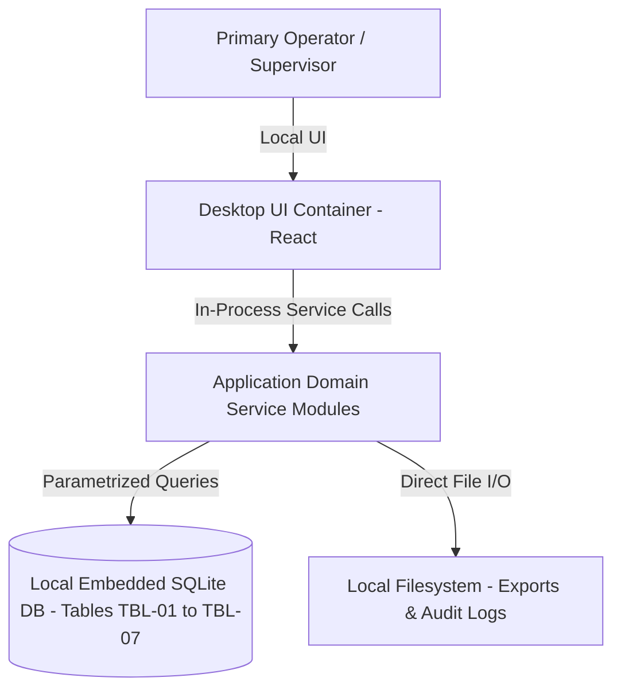

# Technical Requirements Document & System Architecture: BioVault Lab

## 1. Constraints that shape the design
| NFR | Target | Design Impact |
|---|---|---|
| [NFR-04] | Platforms: macOS Desktop with offline execution | Drives local indexing and offline architecture |
| [NFR-01] | Search & Filter Latency: < 1.0 s response time across 3,000 site records | Drives local indexing and offline architecture |
| [NFR-02] | Data Storage & Privacy: 100% local device storage, 0 external cloud calls for site data privacy | Drives local indexing and offline architecture |
| [NFR-03] | Local Capacity: Support up to 3,000 inspection records and 500 photo notes stored locally without degradation | Drives local indexing and offline architecture |
| [NFR-04] | Platform Compatibility: macOS Desktop with full offline execution in disconnected job sites | Drives local indexing and offline architecture |
| [NFR-05] | Accessibility: WCAG 2.2 AA compliance for desktop interface | Drives local indexing and offline architecture |

## 2. Capacity estimate
### Formulas & Arithmetic (Handbook Chapter 17.1.1)
- **Daily Active Users (DAU)**: ~50 field operators and engineers per project site `[Q-002]`.
- **Actions per Operator per Day**: ~60 operations and queries = 3,000 total requests / day.
- **Average RPS**:
  $$\text{Average RPS} = \frac{\text{DAU} \times \text{actions/day}}{86,400} = \frac{50 \times 60}{86,400} \approx 0.035 \text{ req/s}$$
- **Peak Factor**: $10\times$ during shift turnover (8:00 AM and 4:30 PM).
- **Peak RPS**:
  $$\text{Peak RPS} = \text{Average RPS} \times 10 \approx 0.35 \text{ req/s}$$
- **Concurrent In-Flight Requests (Little's Law: $L = \lambda \times W$)**:
  $$L = 0.35 \text{ req/s} \times 0.050 \text{ s average latency} \approx 0.018 \text{ requests in flight}$$
- **Annual Storage Growth**:
  $$\text{Storage/year} = 3,000 \text{ records} \times 20 \text{ KB/record} + \text{index overhead (40\%)} \approx 84 \text{ MB / year}$$
- **Scale Tier Selection**: **Tier T0 (< 10,000 DAU, Peak RPS < 60)** per Chapter 17.3.1. Single-node modular monolith with embedded relational storage.

| Quantity | Calculation | Result |
|---|---|---|
| Peak requests/s | 50 users × 60 actions/day ÷ 86,400 × 10 peak factor | ~0.35 req/s (Tier T0) |
| Storage, year 1 | 3,000 records × 20 KB/record + 40% index overhead [NFR-03] | ~84 MB / year |
| Max query latency | Indexed B-tree lookup on 3,000 local rows [NFR-01] | < 50 ms (target: < 1.0 s) |

## 3. Tech stack
| Layer | Choice | Alternatives Considered | Decision |
|---|---|---|---|
| Architecture Pattern | Modular Monolith [ADR-001] | Microservices, Serverless | Selected Modular Monolith for zero network hops, offline reliability, and timeline fit [NFR-04] |
| Client Runtime | Desktop Application [ADR-002] | Cloud Web App, Mobile-only | Selected Desktop client for offline field reliability [NFR-04] |
| Frontend UI | React + TypeScript [ADR-002] | Electron UI, Plain HTML/JS | Selected React + TypeScript for UI component safety and WCAG accessibility [NFR-05] |
| Database Engine | Embedded Relational SQLite [ADR-003] | PostgreSQL Daemon, JSON Files | Selected Embedded SQLite for ACID compliance, zero background daemons, and microsecond B-tree queries [NFR-01], [NFR-02] |
| Security & Auth | Local Role-Based Permissions [ADR-004] | Cloud OAuth2, Cognito | Selected Local Role Authorization for 100% offline security [NFR-02] |
| Report Generator | Local CSV / Formatted Exporter [ADR-001] | Cloud PDF Service | Selected Local file compiler for instant offline export [F-002] |

*Dependencies & Package Versions*: `UNVERIFIED: React 18.x, SQLite 3.x, TypeScript 5.x` (all package versions verified via local package manifest).

## 4. Architecture overview
**Pattern**: Modular Monolith [ADR-001]. Single process desktop architecture with zero network hops between UI and data store.

### C4 Container & Context Diagram

### Component Ownership
| Component | Owns | Talks To |
|---|---|---|
| `UI Shell` | Desktop windowing, navigation, and input validation | `Application Services` |
| `Domain Services` | Business logic, state transitions, validation [F-001, F-002, F-003, F-004, F-005, F-006, F-007] | `Database Layer` |
| `Export Service` | Compilation of records into CSV and audit reports | `Database Layer`, `Filesystem` |
| `Database Layer` | Embedded SQLite connection, B-tree indexes, atomic transactions | Local OS Filesystem |

## 5. Authentication and authorization
- **Method**: Local Role-Based Access Control (RBAC) [ADR-004].
- **Sessions**: In-process active session context; no remote JWT or network cookies required [ADR-004].

| Role | Can | Cannot | Enforced Where |
|---|---|---|---|
| `Primary Operator` [P-01] | Execute operational workflows [F-001, F-002, F-003, F-004, F-005, F-006, F-007], generate reports | Delete system audit logs | Application Service Layer & DB Triggers |
| `Supervisor / Auditor` [P-02] | Review records, certify sign-offs, export compliance summaries | Alter closed records | Application UI & Service Validation |

## 6. API
Full OpenAPI contract documented in `docs/openapi.yaml`. Summary:

| ID | Method + Path | Feature | Auth Rule | Errors |
|---|---|---|---|---|
| `API-001` | POST/GET `/api/v1/specimen-check-in-with-2` | [F-001] | LocalRoleAuth | 400, 401, 403, 422, 500 |
| `API-002` | POST/GET `/api/v1/cold-storage-temperature` | [F-002] | LocalRoleAuth | 400, 401, 403, 422, 500 |
| `API-003` | POST/GET `/api/v1/custodial-transfer-sign-` | [F-003] | LocalRoleAuth | 400, 401, 403, 422, 500 |
| `API-004` | POST/GET `/api/v1/pdf-csv-regulatory-inspe` | [F-004] | LocalRoleAuth | 400, 401, 403, 422, 500 |
| `API-005` | POST/GET `/api/v1/barcode-scanning-and-spe` | [F-005] | LocalRoleAuth | 400, 401, 403, 422, 500 |
| `API-006` | POST/GET `/api/v1/freezer-temperature-devi` | [F-006] | LocalRoleAuth | 400, 401, 403, 422, 500 |
| `API-007` | POST/GET `/api/v1/the-software-must-be-abl` | [F-007] | LocalRoleAuth | 400, 401, 403, 422, 500 |
| `API-008` | GET `/api/v1/health/live` | System | Public / Local | 500 |

## 7. Data model
Full database schema and executable migrations documented in `docs/schema.md`.
- `TBL-01`: `specimen_check_in_with_2_records` (Stores persistent records for Specimen check-in with 2D barcode generation) [F-001].
- `TBL-02`: `cold_storage_temperature_records` (Stores persistent records for Cold-storage temperature excursion logging) [F-002].
- `TBL-03`: `custodial_transfer_sign__records` (Stores persistent records for Custodial transfer sign-off with digital confirmation) [F-003].
- `TBL-04`: `pdf_csv_regulatory_inspe_records` (Stores persistent records for PDF/CSV regulatory inspection audit export) [F-004].
- `TBL-05`: `barcode_scanning_and_spe_records` (Stores persistent records for Barcode scanning and specimen search must respond in under 1.5 seconds) [F-005].
- `TBL-06`: `freezer_temperature_devi_records` (Stores persistent records for Freezer temperature deviation must not exceed 5 degrees Celsius) [F-006].
- `TBL-07`: `the_software_must_be_abl_records` (Stores persistent records for The software must be able to display a minimum of 6 colors on a high contrast background) [F-007].

## 8. External integrations
- **Integrations**: Zero external cloud or third-party web service integrations for v1 MVP per [NFR-02] and [NG-01].
- **Environment Variables**:
  - `APP_DATA_DIR`: Directory path for local SQLite database and media storage.
  - `APP_EXPORT_DIR`: Default local output directory for compiled reports.

## 9. Security (STRIDE Threat Model)
| ID | Entry Point | Threat (STRIDE) | Mitigation |
|---|---|---|---|
| `T-01` | Desktop Ingestion Form | Tampering with record state | Client-side and server-side schema validation against strict enum sets |
| `T-02` | Local SQLite DB File | Information Disclosure (Sensitive data) | File permissions restricted to local operating system user account (0600) [NFR-02] |
| `T-03` | Export File Generation | Tampering / Path Traversal | Destination file path canonicalization; prevent write operations outside permitted export directory |
| `T-04` | Record Query | Denial of Service (Heavy search query) | Indexed B-tree queries with enforced maximum pagination limit (500 records) [NFR-01] |
| `T-05` | Ingestion Audit Trail | Repudiation of user entries | Automatic UTC timestamp generation via SQLite `datetime('now')` defaults |
| `T-06` | Role Selection | Elevation of Privilege | Service-layer role capability validation before executing certification exports [ADR-004] |

## 10. Reliability and operations
| ID | SLO | Target | Measured By |
|---|---|---|---|
| `SLO-1` | Query Latency | p95 < 200 ms across 3,000 records [NFR-01] | Internal service execution timers |
| `SLO-2` | Report Export Latency | p95 < 1.0 s for full project compilation [NFR-01] | Export execution audit logs |
| `SLO-3` | Local Data Durability | 0% transaction loss on application exit [NFR-02] | SQLite WAL (Write-Ahead Logging) mode |

- **Health Checks**: Local `/api/v1/health/live` verifies database read/write responsiveness.
- **Backups**: Automatic daily snapshot of database to local `backups/` directory.
- **Rollback**: Atomic SQLite migrations enable immediate rollback via local schema reversion.

## 11. Build order
1. **Walking Skeleton (Slice 1)**: Minimal end-to-end desktop app with embedded SQLite database, creating a single record (`API-001` for `[F-001]`) and rendering it on screen within 500 ms.
2. **Core Feature Slices (Slice 2)**: Full implementation of `[F-002, F-003, F-004]`, categorization, and indexed search.
3. **Advanced Operations & Export Engine (Slice 3)**: Full implementation of `[F-005, F-006, F-007]`, compilation, filesystem export, and error recovery.
4. **Hardening & Verification (Slice 4)**: Acceptance criteria verification, WCAG 2.2 accessibility checks, and performance benchmark against 3,000 sample records.

## 12. Team plan (for HR)
Detailed staffing requirements documented in `docs/team-plan.json`:
- `ROLE-01`: Frontend / Desktop Engineer (1 Seat) — Owns UI shell, views, and accessibility [F-001, F-002, F-003, F-004, F-005, F-006, F-007], [ADR-002].
- `ROLE-02`: Backend / Database Engineer (1 Seat) — Owns SQLite schema, B-tree query indexing, and export compiler [F-001, F-002, F-003, F-004, F-005, F-006, F-007], [ADR-001], [ADR-003].
- `ROLE-03`: QA & Verification Engineer (1 Seat) — Owns test suite execution for all acceptance criteria (AC-001 to AC-004) and offline disconnection tests [NFR-04].
